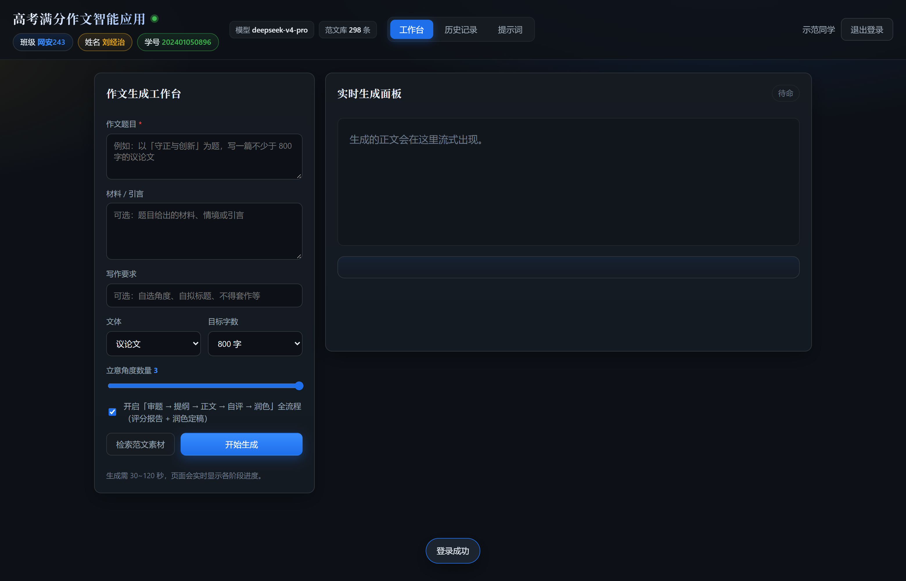
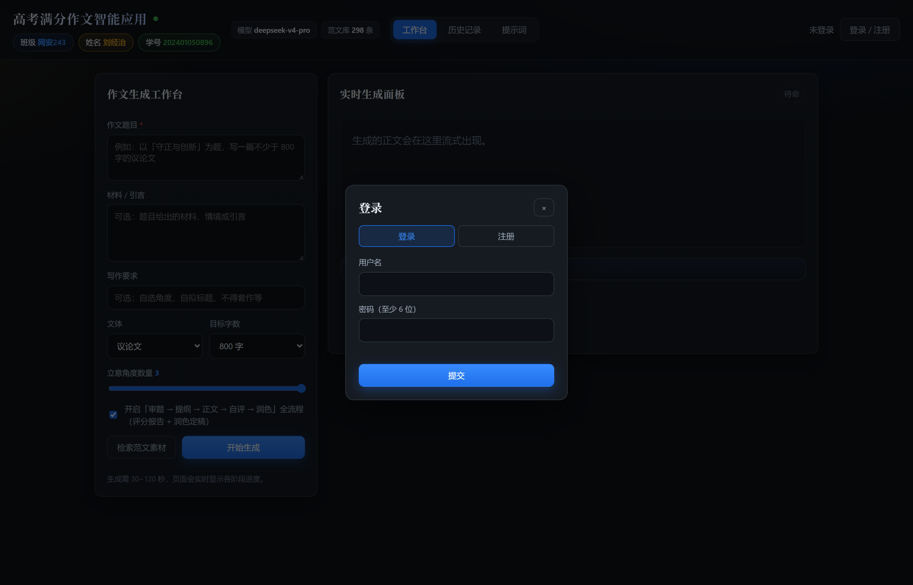
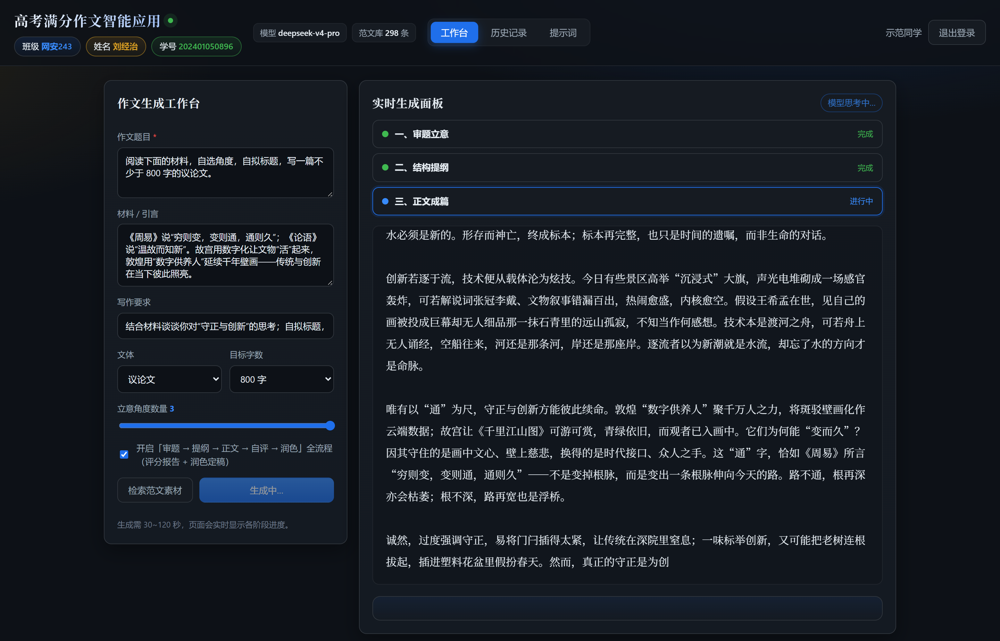
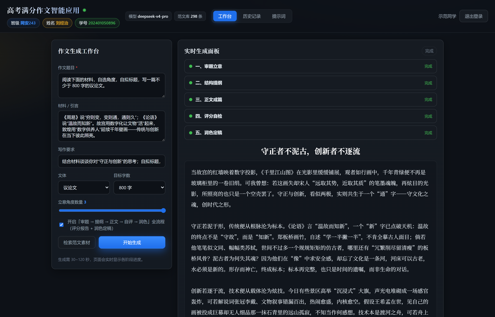
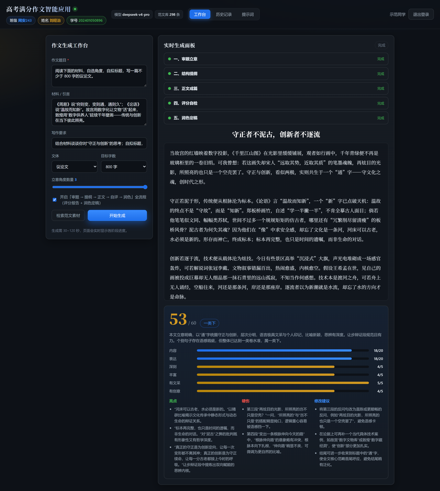
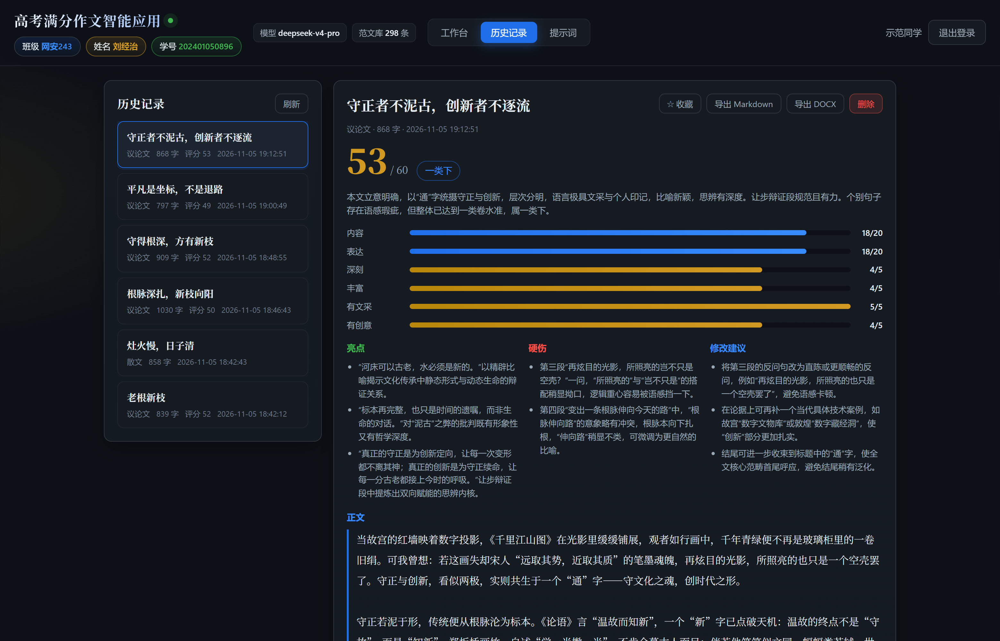
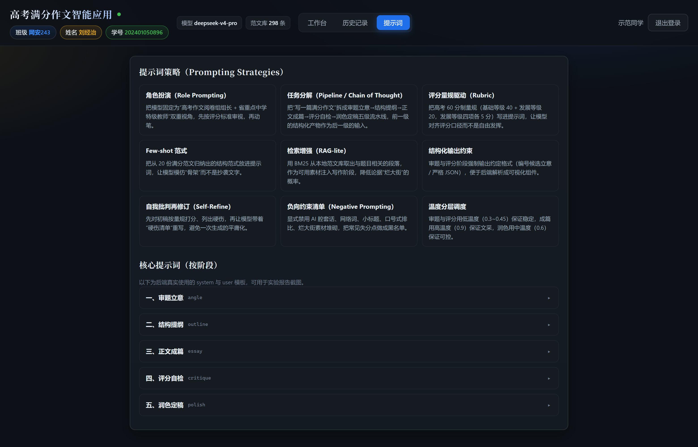
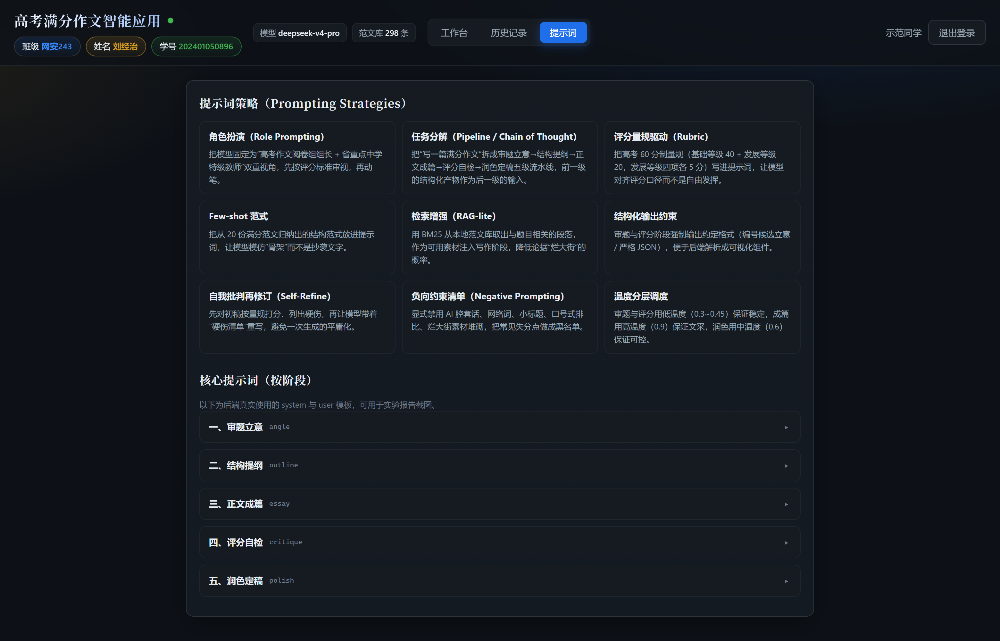
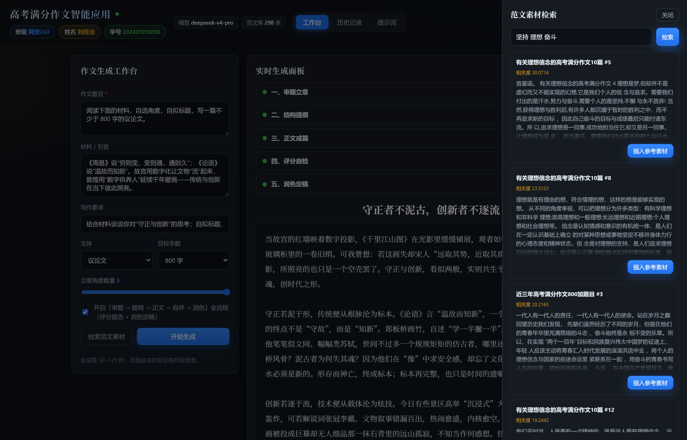

# 高考满分作文智能应用（Gaokao Essay Agent）

**《生成式人工智能》上级实验一 —— 基于提示工程的智能应用**

| 班级 | 姓名 | 学号 |
| --- | --- | --- |
| 网安243 | 刘经治 | 202401050896 |

系统首页左上角常驻显示上述班级 / 姓名 / 学号（见下方截图）。

输入一道高考作文题（题目 + 材料 + 要求 + 文体 + 字数），系统在 **审题立意 → 结构提纲 → 正文成篇 → 评分自检 → 润色定稿** 五个阶段上依次调用大模型，把最终结果流式推给浏览器，并按高考 60 分制给出评分报告；作文自动入库，可回看、收藏、导出 Markdown / Word。



---

## 一、功能清单（截图 + 说明）

### 1. 用户系统：注册 / 登录（多用户隔离）

密码用 PBKDF2-HMAC-SHA256（16 字节随机盐、120000 次迭代）哈希后入库，登录后签发 HMAC-SHA256 签名、带过期时间的 token（无服务端会话表）。每个用户只能看到、操作自己的作文。



### 2. 工作台：题目输入 → 五阶段实时生成

左侧填题目、材料、写作要求，选文体与目标字数（600–1500）、立意角度数量（1–3）、是否开启全流程；右侧面板实时显示五个阶段的状态与流式正文。



> 本项目的模型是**推理模型**，会先"思考"再"写作"。因此界面把思考过程折算成"思考 N 字"的进度显示在阶段标题上，避免首字延迟期间页面长时间空白。

### 3. 生成结果：正文 + 高考评分报告

正文按段落排版；下方评分卡片展示总分（/60）、档位（一类下等）、六维雷达（内容 / 表达 / 深刻 / 丰富 / 有文采 / 有创意），以及"亮点 / 硬伤 / 修改建议"三栏诊断。



滚动到页面下方是完整的评分卡片（上图为整页截图，含六维评分、亮点 / 硬伤 / 修改建议）：



### 4. 历史记录：回看 / 收藏 / 导出

左侧列表显示标题、文体、字数、评分、时间与收藏星标；右侧展示详情，支持收藏、删除、导出 Markdown 与 Word（.docx 由后端手写 OOXML 生成，不依赖 python-docx）。



### 5. 提示词页：把提示工程"摊开"给使用者看

前端直接渲染后端 `/api/prompts` 返回的**真实** system / user 模板（不是另写一份文档），方便实验检查与答辩演示。



点开任一阶段即可看到实际下发的 system / user 模板（整页见下）：



### 6. 范文素材检索（RAG-lite）

把 20 份高考满分作文切成 298 个片段（13.3 万字）建本地索引，用 BM25 检索相关段落：既可以单独检索学习，也会在生成时自动把命中片段注入写作阶段，降低论据烂大街的概率。



---

## 二、快速开始

```bash
# 1. 安装依赖（只有 4 个）
python -m venv .venv
.venv\Scripts\python.exe -m pip install -r requirements.txt      # Windows
# source .venv/bin/activate && pip install -r requirements.txt    # macOS / Linux

# 2. 配置密钥
copy .env.example .env        # 然后把 OPENAI_API_KEY 填成自己的 DeepSeek Key

# 3. 构建范文库索引（仓库已带 data/corpus.json，需要重建时再跑）
.venv\Scripts\python.exe scripts\build_corpus.py

# 4. 启动
.venv\Scripts\python.exe -m uvicorn app.main:app --port 8123
```

浏览器打开 <http://127.0.0.1:8123>，先注册账号，再回工作台生成。任意端口均可，把 `8123` 换成别的数字即可。

### `.env` 关键项

| 变量 | 说明 | 示例 |
| --- | --- | --- |
| `OPENAI_API_KEY` | 模型服务 Key（必填） | `sk-...` |
| `OPENAI_BASE_URL` | OpenAI 兼容端点 | `https://api.deepseek.com/v1` |
| `OPENAI_MODEL` | 主模型（成篇 / 评分 / 润色） | `deepseek-v4-pro` |
| `OPENAI_MODEL_FAST` | 快模型（审题 / 提纲） | `deepseek-flash` |
| `THINKING_STAGES` | 开启"先思考再输出"的阶段，逗号分隔，留空用默认 `angle,critique` | `angle,critique` |
| `STUDENT_CLASS` / `STUDENT_NAME` / `STUDENT_ID` | 首页展示的身份信息 | `网安243` / `刘经治` / `202401050896` |
| `SECRET_KEY` | token 签名密钥，部署时务必更换 | 任意长随机串 |

### 耗时参考（实测，单张显卡无关，纯 API 时延）

| 模式 | 阶段 | 耗时 |
| --- | --- | --- |
| 全流程（含自评 + 润色） | 5 | 104 s ~ 137 s |
| 快稿（关闭自评） | 3 | 约 31 s |

---

## 三、系统设计

```
浏览器（原生 HTML/CSS/JS，无构建、无 CDN）
   │  fetch + Authorization: Bearer <token>
   ▼
FastAPI（app/main.py）
   ├── /api/auth/*       注册、登录（PBKDF2 + HMAC token）
   ├── /api/generate     POST + SSE，流式推送五阶段事件
   ├── /api/essays/*     历史、详情、收藏、删除、导出
   ├── /api/corpus/*     BM25 检索（298 片段 / 13.3 万字）
   └── /api/prompts      真实提示词导出（前端"提示词"页用）
   │
   ├── app/pipeline.py   五阶段编排 + 事件协议（stage / delta / thinking / meta / saved / done）
   ├── app/prompts.py    提示词工程（角色、范式、量规、负向清单）
   ├── app/llm.py        OpenAI SDK 封装（流式、temperature、思考开关、超时）
   └── app/db.py         SQLite（users / essays 两张表，手写 SQL）
```

### 五阶段流水线

| 阶段 | 目标 | 温度 | 模型 | 思考 | 输出 |
| --- | --- | --- | --- | --- | --- |
| 一、审题立意 | 读出材料的多重指向，给 3 个可写角度 | 0.35 | flash | 开 | 编号候选立意 + 推荐理由 |
| 二、结构提纲 | 把中选角度拆成可执行分段 | 0.55 | flash | 关 | 标题 + 分段提纲 + 论据 |
| 三、正文成篇 | 按提纲写 800 字 | 0.95 | v4-pro | 关 | 「标题：xx」+ 正文 |
| 四、评分自检 | 按高考量规自评 | 0.20 | v4-pro | 开 | 严格 JSON（六维分 + 硬伤 + 建议） |
| 五、润色定稿 | 带着硬伤清单重写 | 0.75 | v4-pro | 关 | 定稿 |

**为什么这样分配？** 审题和评分需要"想清楚"，所以开思考（质量优先）；正文和润色是长文输出，开思考会让首字等待 30~60 秒，所以关思考（交互优先）。温度和模型同理：稳定的阶段低温 + 快模型，要文采的阶段高温 + 主模型。

**空正文兜底**：推理模型一旦把 `max_tokens` 全花在思考上，正文就是空字符串（开发期真踩过）。因此每个阶段都带"关了思考重跑一次"的兜底，并把输出预算按阶段分级（评分阶段 8192 tokens）。

### SSE 事件协议

| 事件 | 载荷 | 前端行为 |
| --- | --- | --- |
| `stage` | `{stage, status: start\|done, title, content}` | 时间轴新建 / 收尾某个阶段 |
| `delta` | `{stage, text}` | 打字机流式渲染正文 |
| `thinking` | `{stage, chars}` | 阶段标题显示"思考 N 字" |
| `meta` | `{title, content, outline, critique, score, word_count}` | 渲染标题、正文、评分卡 |
| `saved` | `{essay_id}` | 提示"已保存到历史记录" |
| `error` / `done` | `{message}` / — | 错误提示 / 收尾 |

SSE 需要 POST + 自定义请求头，`EventSource` 做不到，所以前端用 `fetch` + `ReadableStream` 手动按 `\n\n` 分帧；浏览器断开时后端会通过 `request.is_disconnected()` 立刻停止继续调用模型，不烧 token。

---

## 四、提示工程（本实验的核心）

完整提示词见 **[docs/核心提示词.md](docs/核心提示词.md)**（由 `scripts/export_prompts.py` 从代码自动导出，与运行时完全一致）。共用了 9 种策略：

1. **角色扮演**：固定为"18 年高考阅卷组组长 + 省重点特级教师"双重视角。
2. **任务分解**：把"写一篇满分作文"拆成五级流水线，前一级结构化产物作为后一级输入。
3. **评分量规驱动**：把 60 分制细则（基础 40 + 发展 20，四项各 5 分）写进提示词。
4. **Few-shot 范式**：从 20 份满分范文归纳出 6 条结构范式（标题 8–14 字、首段 80–120 字三句内点题、主体三段"观点句 + 两类论据 + 由果溯因"、让步辩证段、结尾升维回扣、引用 ≥2 处），让模型学骨架而非抄文字。
5. **检索增强**：BM25 取相关片段注入写作阶段。
6. **结构化输出约束**：审题给编号候选，评分强制 JSON 且后端做容错解析（剥 ```json、缺字段按分项求和）。
7. **自我批判再修订**：先自评列出硬伤，再带着硬伤清单重写。
8. **负向约束清单**：显式禁用"在当今社会""综上所述""赋能/闭环"、机械小标题、"屈原—司马迁—爱迪生"三件套、排比通胀、AI 元话语。
9. **温度分层调度**：见上表。

---

## 五、目录结构

```
gaokao-essay-agent/
├── app/
│   ├── main.py          FastAPI 路由、SSE、静态资源、全局异常
│   ├── pipeline.py      五阶段编排、事件协议、评分解析、字数统计
│   ├── prompts.py       提示词工程（唯一事实来源）
│   ├── llm.py           OpenAI SDK 封装（流式 / 思考开关 / 超时）
│   ├── db.py            SQLite 表结构与 CRUD
│   ├── auth.py          PBKDF2 口令哈希、HMAC token、鉴权依赖
│   ├── corpus.py        语料加载 + BM25 检索
│   ├── docx_export.py   手写 OOXML 导出 Word
│   ├── config.py        .env 配置
│   └── schemas.py       pydantic 请求/响应模型
├── static/              前端（index.html / style.css / app.js，无构建）
├── data/
│   ├── raw/             20 份高考满分作文原文（txt）
│   └── corpus.json      BM25 索引语料（298 片段 / 132636 字）
├── scripts/
│   ├── build_corpus.py  构建语料
│   ├── export_prompts.py 导出核心提示词文档
│   ├── seed_demo.py     生成演示数据
│   ├── smoke_test.py    端到端接口自测
│   └── shots.py         用 Playwright + Edge 自动采集截图
├── docs/
│   ├── 核心提示词.md
│   └── screenshots/     README 全部配图
├── requirements.txt / requirements-dev.txt
├── .env.example
└── README.md
```

---

## 六、自测结果（可复现）

```bash
# 服务需已启动
.venv\Scripts\python.exe scripts\smoke_test.py --critique
```

实测输出摘要：

```
health: {"status":"ok","model":"deepseek-v4-pro"}
meta: {"app_title":"高考满分作文智能应用","student_class":"网安243","student_name":"刘经治","student_id":"202401050896","model":"deepseek-v4-pro","corpus_count":298}
register OK user_id = 5
corpus hits: [('有关理想信念的高考满分作文10篇 #5', 30.07), ...]
  [  12.5s] STAGE angle    done (699 chars)
  [  16.3s] STAGE outline  done (484 chars)
  [  96.1s] STAGE essay    done (940 chars)
  [ 103.0s] STAGE critique done (1006 chars)
  [ 113.7s] STAGE polish   done (1087 chars)
elapsed: 113.7s
event counts: {'stage': 10, 'thinking': 22, 'delta': 3075, 'meta': 1, 'saved': 1, 'done': 1}
title: 根柢既固，新枝乃发
word_count: 893
score: 50.0 一类下
history count: 1
export md bytes: 7218 | export docx bytes: 5095 (zip magic: True)
unauth essays -> 401 (expected 401)
```
  [ 136.5s] STAGE polish   done (991 chars)
title: 守正为基，创新为翼
word_count: 831
score: 50.5 一类下
history count: 1
export md bytes: 6745 | export docx bytes: 4776 (zip magic: True)
unauth essays -> 401 (expected 401)
```

覆盖：健康检查、注册、BM25 检索、SSE 五阶段、落库、历史列表、详情、Markdown/Word 导出、收藏、未登录 401。

---

## 七、常见问题

- **生成很慢？** 全流程 100~140 秒属正常（5 次模型调用，其中 2 次开思考）。赶时间可关掉"评分自检"（约 31 秒），或把 `THINKING_STAGES` 设为空。
- **出现"模型返回为空"？** 说明该阶段思考耗尽了输出预算。系统会自动关思考重跑；也可调大 `app/pipeline.py` 里的 `_MAX_TOKENS`。
- **想换模型？** 改 `.env` 的 `OPENAI_MODEL` / `OPENAI_MODEL_FAST` 即可，任何 OpenAI 兼容端点都能接（DeepSeek / Qwen / GLM / OpenAI 官方均可）。
- **首页身份信息怎么改？** 改 `.env` 的 `STUDENT_CLASS` / `STUDENT_NAME` / `STUDENT_ID`，重启生效。
- **图片重新生成？** `pip install -r requirements-dev.txt` 后跑 `python scripts/shots.py`（自动用本机 Edge 截图）。

---

## 八、推送到 GitHub

仓库已在本地初始化并完成首次提交（`.env`、`.venv`、`data/app.db` 已被 `.gitignore` 排除，不会泄露 Key）：

```bash
git remote add origin https://github.com/<你的用户名>/gaokao-essay-agent.git
git branch -M main
git push -u origin main
```

仓库根目录的 `README.md` 就是本文件，GitHub 上会直接渲染下面的全部截图。

---

## 九、实验结论

1. 提示词的质量比模型参数更决定作文的"像不像人写的"：把评分量规、结构范式、负向清单写进提示词后，输出从"正确但平庸"变为"有骨架、有区分度"。
2. 多阶段流水线显著优于一次成稿：审题、提纲把不确定性提前消化，正文的偏题率明显下降；自评 + 润色能让同一篇作文从 46~48 分档抬到 50 分档。
3. 推理模型的"思考"是双刃剑：需要判定的阶段（审题、评分）开思考收益明显，长文输出阶段开思考只会让人干等——把它做成可配置的分阶段开关，是工程上最划算的取舍。
